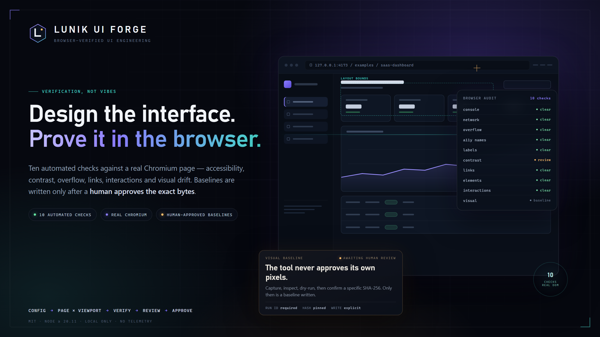
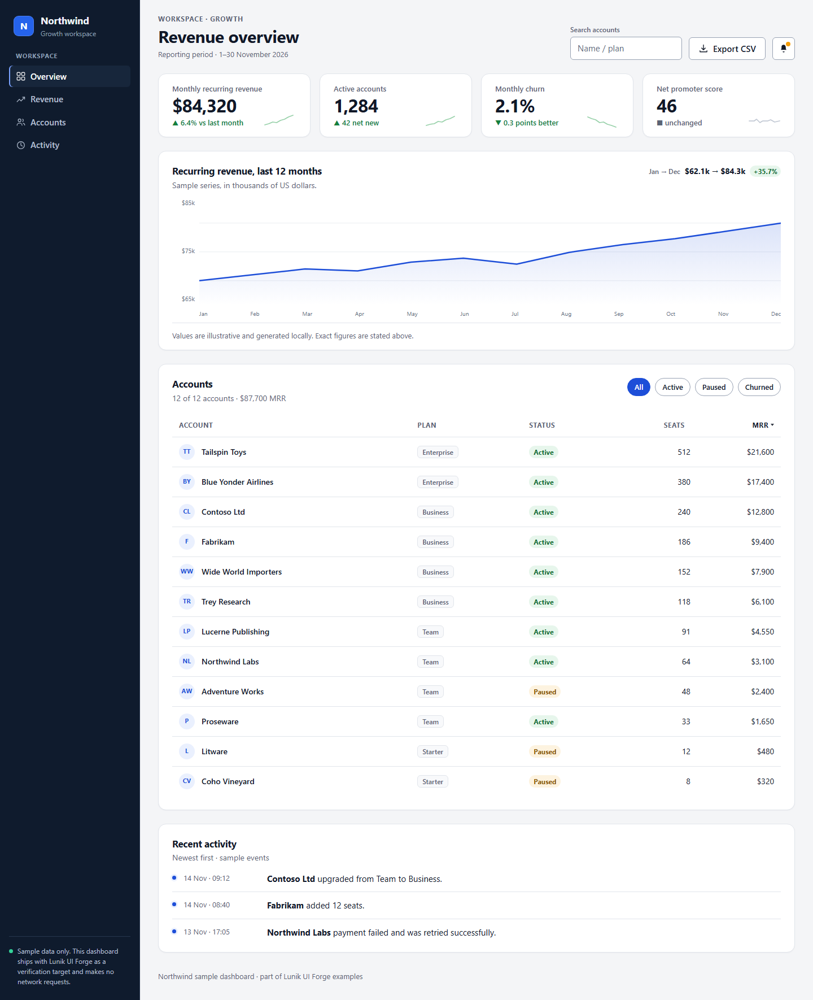
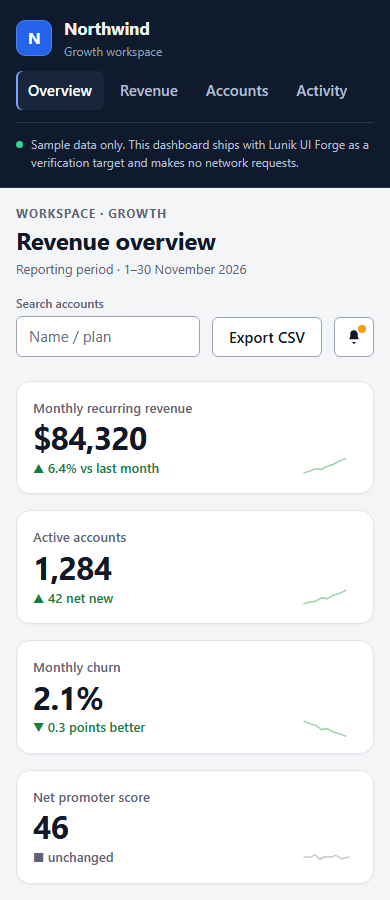
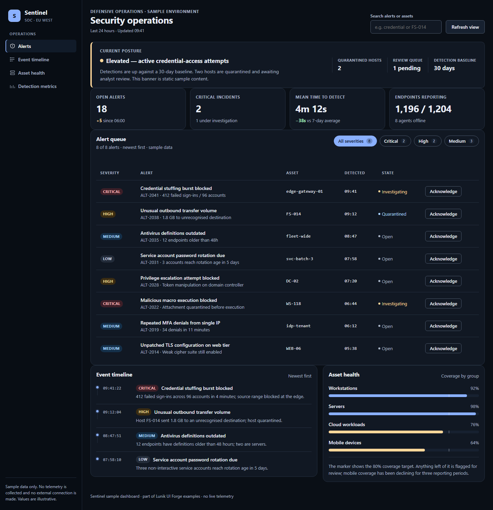
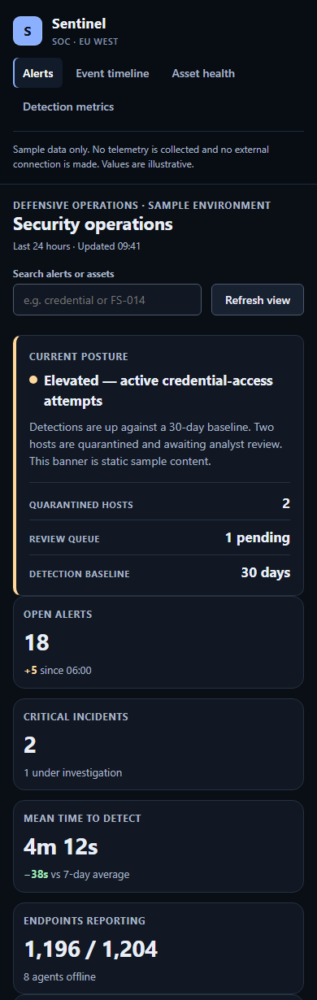
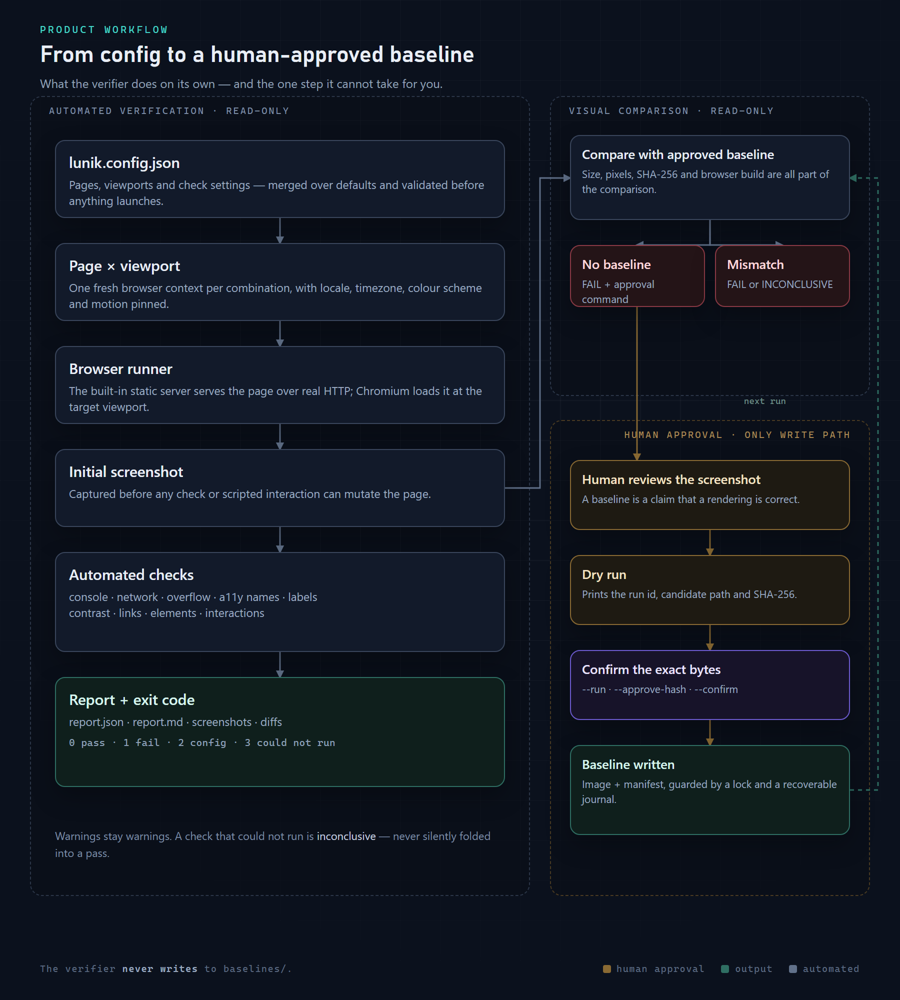
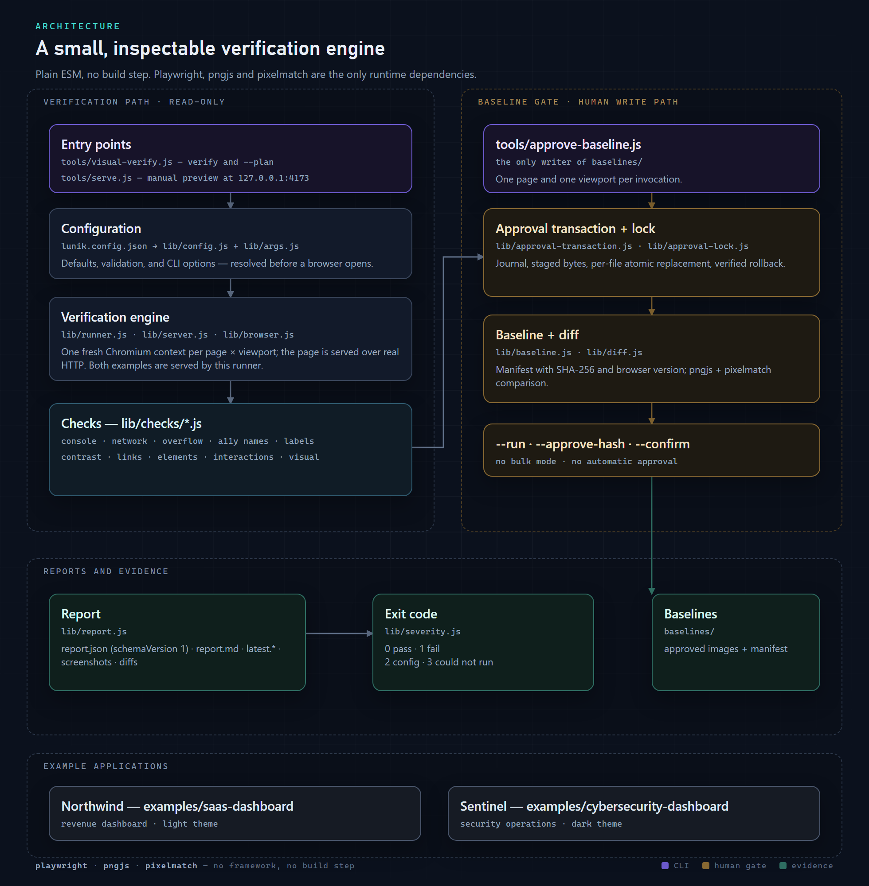

<p align="center">
  
</p>

# Lunik UI Forge

**Browser-verified UI engineering for AI agents and developers.**

`v0.1.0` · MIT · Node.js ≥ 20.11 · Chromium

Lunik UI Forge is a verification layer for interface work. It gives an AI agent
or a developer a repeatable way to go past “the screenshot looks fine”: render
the page in a real browser, run ten checks, capture a deterministic screenshot,
compare it with an approved baseline, and produce evidence for every verdict.

It is not a component library, a design generator, or a screenshot service. It is
the part that decides whether a UI still behaves — and still looks — the way a
human agreed it should.

> **First release.** Version 0.1.0 is the first implementation of this toolkit.
> No visual baselines are shipped. On a fresh checkout `npm run verify` reports
> **54 passed and 6 failed**, and all six failures are the visual check waiting
> for a human-approved baseline. That is the designed first run, not a broken
> install. See [Baselines are a human decision](#baselines-are-a-human-decision).

**Contents:** [What it checks](#what-it-checks) · [Examples](#see-it-in-action) ·
[How a run works](#how-a-run-works) · [Install](#install) ·
[Baselines](#baselines-are-a-human-decision) · [Documentation](#documentation)

## What you get

- **Ten browser checks** with page, viewport, severity, evidence, a suggested
  fix, and artifact paths — not a single green/red line.
- **A real browser and a real origin.** Playwright Chromium loads every page over
  HTTP — from the built-in static server for local `path` pages, or from the URL
  you provide — at each configured viewport.
- **Screenshots and pixel diffs** produced under fixed locale, timezone, colour
  scheme, reduced-motion, and device-scale conditions.
- **A human-controlled baseline gate.** The verifier can read baselines; it can
  never write one. Approval is a separate command with a run id, a specific
  SHA-256, and `--confirm`.
- **Two complete example applications** — Northwind, a SaaS revenue dashboard,
  and Sentinel, a security operations console — both static and dependency-free.
- **No LLM calls, no telemetry, no API keys.** Verification is local and does not
  depend on the public internet.

## What it checks

| Check | What it catches |
| --- | --- |
| `console` | Uncaught exceptions and `console.error` during load and interactions |
| `network` | Failed requests and 4xx/5xx responses, with a bounded observation window |
| `overflow` | Horizontal page scroll, with the offending elements named |
| `a11yNames` | Controls and images with no accessible name, read from the real accessibility tree |
| `labels` | Form controls without an associated label, and `label[for]` pointing nowhere |
| `contrast` | WCAG 2.2 AA text contrast, plus an explicit “could not measure” count |
| `links` | Broken same-origin links, unresolved `#fragment`s, and placeholder links |
| `elements` | Expected selectors that are missing, hidden, or contain the wrong text |
| `interactions` | Scripted flows that no longer reach the expected state |
| `visual` | A screenshot that differs from the approved baseline |

Every result carries the page, viewport, severity, status, evidence, remediation,
artifacts, and duration. Warnings stay warnings. A check that ran but could not
produce a trustworthy answer is `inconclusive` — never folded into a pass.

## See it in action

Both examples ship with the repository, their design rationale, and real
screenshots captured from the actual pages.

### Northwind — a SaaS revenue dashboard



*The full Northwind dashboard at 1440px width (1440 × 1770). Source:
[`examples/saas-dashboard/`](examples/saas-dashboard/).*

Northwind is a calm, light workspace for a growth team: a metric row, a revenue
trend, a filterable accounts table, an empty state, and an activity feed. The
sidebar becomes a horizontal navigation strip on narrow screens, the metric row
stacks, and the table scrolls inside its card rather than widening the page.

<p align="center">
  
</p>

*The same page at 390 × 900. The navigation, sample-data note, search, and metric
stack are visible; no card is cut off.*

Design decisions and accessibility notes:
[`examples/saas-dashboard/DESIGN.md`](examples/saas-dashboard/DESIGN.md).

### Sentinel — a security operations console



*The full Sentinel dashboard at 1440px width (1440 × 1490). Source:
[`examples/cybersecurity-dashboard/`](examples/cybersecurity-dashboard/).*

Sentinel is a dark, dense console for an analyst working a queue: a posture
banner, four operational metrics, severity filters, an alert table, a timeline,
and asset-health meters. Severity and state are always carried by text as well
as colour. The alert queue scrolls inside its card, with a labelled cue rather
than a hidden scrollbar.

<p align="center">
  
</p>

*The same page at 390 × 1230. Posture facts become label/value rows and the
metric row stacks without horizontal page scroll.*

Design decisions and accessibility notes:
[`examples/cybersecurity-dashboard/DESIGN.md`](examples/cybersecurity-dashboard/DESIGN.md).

## How a run works

1. **Load and validate `lunik.config.json`.** Pages, viewports, check settings,
   severities, and thresholds are merged over defaults. A bad value exits `2`
   before a browser opens.
2. **Create one fresh context per page × viewport.** Locale, timezone, colour
   scheme, reduced motion, and device scale are pinned so rendering does not
   depend on the host machine.
3. **Serve local pages over real HTTP.** The built-in static server refuses paths
   outside the project root and sets `Cache-Control: no-store`. A page configured
   with `url` is loaded directly from that origin instead.
4. **Capture the initial screenshot.** It is taken before any check or scripted
   interaction can mutate the page.
5. **Run the checks.** The visual check compares that already-captured image
   against the approved baseline. It only reads `baselines/`.
6. **Run the scripted interactions last.** Each flow starts from a fresh load.
   When interactions are configured, console and network are finalised after a
   bounded observation window so a request raised by the final step is not
   missed.
7. **Write the report and choose an exit code.** `report.json`, `report.md`, and
   the screenshots are written per run; the four exit codes are listed below.



*The automated path is read-only. Only the human approval path writes to
`baselines/`.*

## Architecture



The tool is plain ESM with no build step. `tools/visual-verify.js` and
`tools/approve-baseline.js` are the entry points; `tools/lib/runner.js`
orchestrates the browser run; `tools/lib/checks/` contains one module per check;
`tools/lib/report.js` writes the evidence; and the baseline gate is split across
`approval-transaction.js`, `approval-lock.js`, `baseline.js`, and `diff.js`.

Two decisions are worth knowing:

- **Checks run inside the page.** Accessible names come from Chromium’s
  accessibility tree; contrast, labels, and overflow are computed from the live
  DOM and computed styles. Auditing markup with a DOM emulator would disagree
  with what a user sees.
- **Playwright’s `toHaveScreenshot()` is deliberately not used.** Its
  `--update-snapshots` mode rewrites baselines in place, which is exactly the
  automatic approval this project forbids. The diff is owned here, so approval
  can stay a separate, explicit command.

More detail: [Architecture and decisions](docs/architecture.md).

## Install

Node.js **20.11 or newer** is required. From the project root:

```bash
npm install
npx playwright install chromium
```

If you already have Chrome or Edge installed, you can skip the Chromium download
and point the verifier at the installed browser in `lunik.config.json`:

```json
{ "browser": { "channel": "chrome" } }
```

`"msedge"` also works. If the browser cannot launch, verification exits `3` with
the install command in the message; it never reports a pass without a browser.

## Quick start

```bash
node tools/visual-verify.js --plan
npm run verify
npm run serve
```

`--plan` validates the configuration and writes nothing; it prints the effective
pages, viewports, checks, output locations, and the next command. `npm run verify`
audits both examples at three viewports, and `npm run serve` previews them at
`http://127.0.0.1:4173`.

The first real verification exits `1` with **54 passed and 6 failed**. All six
are `visual` checks reporting *“No approved baseline”* for the two examples at
three viewports. Nothing else should fail. If another check fails, it is a real
finding — read `reports/latest.md`.

### Exit codes

| Code | Meaning |
| --- | --- |
| `0` | Every required check passed. Warnings may still be present. |
| `1` | At least one check failed. Read the report. |
| `2` | Usage or configuration error. Nothing was verified. |
| `3` | Verification could not run: browser, environment, navigation, or an inconclusive check. |

Code `3` exists so “the browser never started” can never be mistaken for “we
checked and it is fine” in a script or CI job.

### Approve your first baseline

A baseline is a claim that a rendering is correct, so approval is deliberately
two steps and deliberately human.

1. Capture the page and viewport:

   ```bash
   node tools/visual-verify.js --page saas-dashboard --viewport desktop
   ```

2. Open the screenshot path printed in the report and look at it.

3. Dry-run the approval. This writes nothing; it prints the run id, candidate
   path, image size, and SHA-256:

   ```bash
   node tools/approve-baseline.js --page saas-dashboard --viewport desktop
   ```

4. Confirm exactly the bytes the dry run printed:

   ```bash
   node tools/approve-baseline.js --page saas-dashboard --viewport desktop --run "RUN_ID" --approve-hash "SHA256" --note "initial approved baseline" --confirm
   ```

Replace `RUN_ID` and `SHA256` with the values the dry run printed. The quotes keep
the placeholders literal in PowerShell and `cmd`; the tool rejects them until they
are replaced. This one-line form works in PowerShell, `cmd`, and bash. The
documentation also shows a bash-style line continuation (`\`); PowerShell uses a
backtick instead.

A hash that does not match the candidate is refused and nothing is written.
Approval is one page and one viewport per invocation; there is no bulk mode.

## CLI

### Verify

```bash
node tools/visual-verify.js --plan
node tools/visual-verify.js
node tools/visual-verify.js --page saas-dashboard --viewport mobile
node tools/visual-verify.js --strict
node tools/visual-verify.js --quiet
node tools/visual-verify.js --config path/to/other.config.json
node tools/visual-verify.js --root "C:/path with spaces/project"
```

`--strict` turns warnings into failures; `--quiet` prints only the final summary.
The forward-slash Windows path works in PowerShell, `cmd`, and Git Bash.

### Approve and preview

```bash
node tools/approve-baseline.js --page saas-dashboard --viewport desktop
node tools/approve-baseline.js --page saas-dashboard --viewport desktop --run "RUN_ID" --approve-hash "SHA256" --confirm
node tools/serve.js --port 4173
```

### npm scripts

| Script | Command |
| --- | --- |
| `npm run verify` | `node tools/visual-verify.js` |
| `npm run verify:strict` | `node tools/visual-verify.js --strict` |
| `npm test` | Unit tests, no browser required |
| `npm run test:browser` | Browser/integration tests |
| `npm run test:all` | Both suites |
| `npm run approve-baseline` | `node tools/approve-baseline.js` (still needs its arguments) |
| `npm run serve` | `node tools/serve.js` |

All options and their validation rules are in
[Configuration § CLI flags](docs/configuration.md#cli-flags).

## Configuration

Everything is driven by `lunik.config.json` at the project root. A page is either
served from the project root with `path`, or already running elsewhere with
`url`.

```json
{
  "viewports": [
    { "name": "desktop", "width": 1440, "height": 900 },
    { "name": "mobile", "width": 390, "height": 844 }
  ],
  "pages": [
    {
      "id": "home",
      "path": "/index.html",
      "expect": { "selectors": ["h1", "nav"] },
      "interactions": [
        {
          "name": "empty state is reachable",
          "steps": [
            { "click": "[data-filter='churned']" },
            { "expectVisible": "[data-empty-state]" }
          ]
        }
      ]
    }
  ],
  "checks": {
    "contrast": { "enabled": true, "severity": "warning" },
    "visual": { "enabled": true, "maxDiffRatio": 0.001, "pixelThreshold": 0.1 }
  }
}
```

- `id` becomes a directory under `reports/` and `baselines/`, so it must match
  `^[a-z0-9][a-z0-9._-]*$`. Viewport names use the same rule.
- `path` starts with `/` and is served from the project root by the built-in
  static server. If your app is already running in dev mode, use `url` instead;
  `url` wins when both are present.
- `expect.selectors` tells `elements` what must be present and visible.
  `interactions` scripts flows that must keep working.
- `design` is documentation only. The verifier does not parse it.

Every field, threshold, and interaction step:
[Configuration](docs/configuration.md).

## Reports and evidence

```text
reports/<run-id>/
├── report.json                 machine-readable, schemaVersion 1
├── report.md                   human-readable summary
├── screenshots/<page>/<viewport>.png
└── diffs/<page>/<viewport>.png     only when a comparison produced a diff
```

`reports/latest.json` and `reports/latest.md` are copies of the newest run.
`reports/` is disposable and git-ignored; `baselines/` is not.

A failed run is meant to be useful without rerunning it: the report names the
page, viewport, check, severity, observed evidence, a suggested fix, and the
artifact paths. Start with the screenshot.

## Baselines are a human decision

`tools/visual-verify.js` **never writes** to `baselines/`. A missing or
unapproved baseline is a **failure**, not a skip and not a warning. Approving is
the only write path, and it requires all three of `--run`, `--approve-hash`, and
`--confirm`.

The approval records the image’s SHA-256, the run and candidate it came from,
what it replaced, and an append-only history in `baselines/manifest.json`. A
baseline edited by hand is detected and reported as `inconclusive` instead of
being trusted. A baseline recorded on a different browser build is also
`inconclusive`: rendering differs between builds, so the comparison is not
trustworthy.

The approval transaction takes an exclusive lock, writes a journal, stages and
hashes the candidate, replaces each file atomically, and verifies a rollback if
something fails. It is about process failure on a live filesystem, not power
loss; the exact durability boundary is documented in
[Verification § Durability boundary](docs/verification.md#durability-boundary).

### What a baseline covers

One baseline is one screenshot of the **first viewport**, captured before any
interaction, with motion frozen and locale, timezone, colour scheme, and device
scale pinned. It does **not** cover:

- content below the fold, or the full page;
- another viewport width;
- hover, focus, disabled, empty, or post-interaction states;
- a scrolled table position;
- whether the layout is actually good.

A green visual check means one image still matches an image a human approved.
It does not mean the interface is correct. The other nine checks cover different
failure modes; responsive behaviour is covered by the browser test suite.

Demonstration baselines are deliberately not shipped, because a baseline is tied
to the browser build that produced it. The honest first-run state is the point.

## Project structure

```text
assets/                  branding, screenshots, editable diagram sources
baselines/               approved screenshots + manifest (empty until you approve)
docs/                    getting started, configuration, verification, architecture…
examples/                Northwind (saas-dashboard) and Sentinel (cybersecurity-dashboard)
knowledge/               design principles, tokens, accessibility, layout, heuristics
skills/                  agent workflow + machine-readable manifest
tests/                   unit + browser tests, with pass and deliberately-failing fixtures
tools/                   visual-verify.js, approve-baseline.js, serve.js, lib/, lib/checks/
lunik.config.json        pages, viewports, check settings
```

## Testing

```bash
npm test
npm run test:browser
npm run test:all
```

`npm test` runs the unit suite without a browser; `npm run test:browser` runs the
integration suite in Chromium; `npm run test:all` runs both.

At version 0.1.0 the suite is **135 unit tests and 90 browser tests (225
total), all passing**. The browser suite includes fixtures that must fail, the
example dashboards’ interaction coverage, and the full baseline-approval safety
model.

## Known limitations

- **No baselines are shipped.** Every visual check fails on a fresh checkout
  until a human approves that page and viewport, and baselines are only
  comparable on the class of machine and browser build that produced them.
- **Contrast cannot see everything.** Text over images or gradients and
  `opacity` chains are counted as unmeasurable, which is why contrast defaults
  to `warning` severity.
- **External links are not fetched.** Verification must not depend on the public
  internet. External hosts are counted, not requested.
- **Network observation is bounded, not monitoring.** A request that starts after
  the observation window is outside scope. A green network result means “no
  failure among the requests that were observed”.
- **The visual check is narrow by design.** Only the first viewport,
  pre-interaction, with no full-page, hover, focus, or below-the-fold coverage.
- **Automated checks do not judge taste.** Hierarchy and appropriateness still
  need a human or the heuristics checklist.
- **The Claude Code adapter is documented, not executed.** Claude Code was not
  available in the environment where this was built.
- **No automatic baseline updates, auto-fix mode, or autonomous redesign loop.**

## Documentation

- [Getting started](docs/getting-started.md) — install, first run, first approval
- [Configuration](docs/configuration.md) — pages, viewports, checks, CLI flags
- [Verification](docs/verification.md) — what each check proves, and its limits
- [Architecture](docs/architecture.md) — module boundaries and decisions
- [Integrations](docs/integrations.md) — adapter contract and a CI example
- [Troubleshooting](docs/troubleshooting.md) — browser launch, config, baselines
- [Contributing](docs/contributing.md) — setup, adding a check, tests

## Contributing

Contributions are welcome. The project is plain ESM with no build step, so a
change is reviewable as the file that runs. For a new check, add a module under
`tools/lib/checks/`, register it in `tools/lib/runner.js`, give it a default in
`tools/lib/config.js`, and add a fixture that fails. Run `npm run test:all`
before opening a pull request. Details: [Contributing](docs/contributing.md).

## Licence and acknowledgements

MIT — see [LICENSE](LICENSE).

Runtime dependencies are `playwright` (Apache-2.0), `pngjs` (MIT), and
`pixelmatch` (ISC). The unit tests use `node:test`, the static server uses only
the Node standard library, and the browser tests reuse Playwright. Full license
notes: [THIRD-PARTY-NOTICES.md](THIRD-PARTY-NOTICES.md).

The branding, diagrams, and both example dashboards are original work created
for this project. No third-party logos, stock imagery, or code from the
unverified inspiration links are included.
